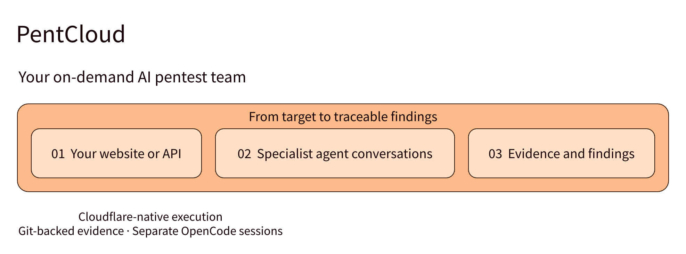
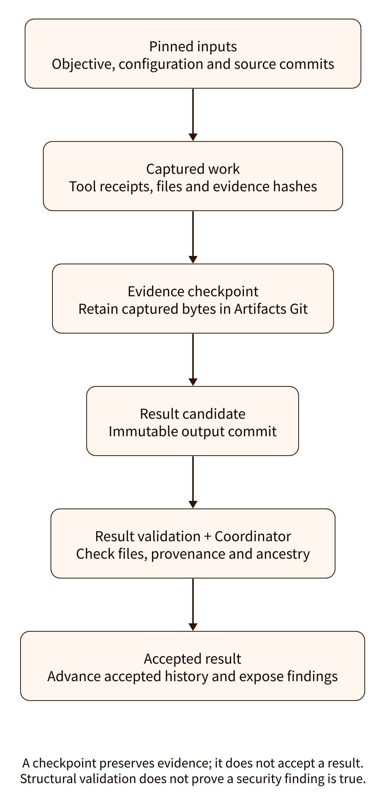

# PentCloud

**Your on-demand AI pentest team.**

I created PentCloud so nontechnical people can do real penetration testing on their
own projects with as little setup and manual effort as possible. Save a website or
API, choose your models and follow specialist agents using real security tools.
Review the evidence, understand the findings and decide what to fix next.

**Open-source preview.** Review the documented installation and operational limits. Each installation
belongs to one owner or a trusted team in their own Cloudflare account. See
[installation limits](#know-the-boundaries) before deployment.

[Website](https://pentcloud.dev/) · [Interactive demo](https://demo.storylane.com/share/y3kxnxrtlt7i) · [Get started](#get-started) · [How it works](#from-target-to-traceable-findings) ·
[Architecture](docs/architecture.md) · [PentAGI comparison](#how-pentcloud-differs-from-pentagi)

## Get started

Choose your Cloudflare account and a Worker name. Cloudflare copies the repository
and runs Workers Builds to deploy the app and eleven smaller tool packages in your
account. Open the deployed app for the three-step setup wizard: protect it with
Cloudflare Access, prepare the Artifacts workspace, and connect OpenCode. Existing
configured installations open the app directly; revisit the wizard at `/setup`.
See [deployment prerequisites and validation](docs/deployment.md).

### Before you start

| Requirement | Recommended starting choice |
| --- | --- |
| Cloudflare subscription | **Workers Paid (Standard), $5/month minimum**, plus usage; no Pro/Business website plan needed |
| Operator access | **Zero Trust Free / Access**, $0 within its 50-user limit |
| Model access | **OpenCode Go, $10/month**, recommended for a solo first install when its catalog fits; Console pay-as-you-go is an alternative |
| Model credential | A workspace API key with **Models → Request**, entered directly into a Cloudflare app Worker Secret |
| Source development tools | Node 26.12.1 or later 26.x, Go 1.26.5, Git, Bash, npm and Python 3.11+; the customer wizard runs in the browser |

**Starting subscriptions: $15/month with Go, plus metered usage.** This is not
an all-inclusive assessment price. Containers, browser time, storage, logs and
other meters have shared included allowances and overages. Artifacts billing
starts November 12, 2026; log pricing changes December 1. Prices checked
November 4, 2026. See [requirements, add-ons and cost details](docs/requirements.md)
for source links, service entitlements and optional charges. You need one working
OpenCode billing route, not both keys or a separate vendor key for each agent.

Setup reference: [Cloudflare account and OpenCode key walkthrough](docs/cloudflare-setup.md).
For errors: [Setup and runtime debugging](docs/operations/debugging.md).

## From target to traceable findings

1. **Save your target.** Add a website or API, confirm authorization and verify the
   address. Optionally import a public bounty program and add target-bound
   headers/login references. The target stays available for later runs.
2. **Prepare while the toolbox starts.** Configure OpenCode models by agent role,
   attach documents/source/configs and add optional source context. Open the primary
   conversation once setup passes; preparation stays read-only while discovery runs.
3. **Follow the investigation.** Open each specialist's conversation, watch streaming
   text and tool activity, and steer the work when needed.
4. **Review the result.** Select a saved target in Findings, inspect observations
   across retained runs, open evidence and read or download the assessment.

[See the full journey](media/journey.light.svg) ·
[Target setup and current limits](docs/operations/onboarding.md)

## Built for investigations you can follow

| Capability | What it gives you |
| --- | --- |
| **Agentic security testing** | A primary agent and specialists use browser, HTTP and bounded tool-package capabilities for an authorized assessment. |
| **Git-backed evidence** | Pinned inputs, captured files and accepted output commits connect results to a reviewable work history. |
| **Durable orchestration** | Recorded state, receipts and supported recovery paths keep interruptions visible. Uncertain remote actions require reconciliation. |
| **Separate agent sessions** | Each revision has its own OpenCode session/workspace. Specialist conversations remain individually accessible. |
| **Source-informed testing** | Reference separate source repositories at exact per-run commits, alongside bounded document/source/config attachments. |
| **Model flexibility** | Choose supported OpenCode models per role, including explicitly configured Console BYOK connections. |
| **Cloudflare-native runtime** | Workers, Durable Objects, Artifacts, Browser Run and on-demand tool Containers run in your account. |

Separate sessions do not mean parallel scans or a private Container for each agent.
One mutating attempt runs at a time, with at most two waiting. Read-only preparation
can continue during initial discovery.

## Evidence with a history

**Real tools. Reviewable work.** Captured evidence can remain available after a
failed or interrupted attempt. The reporter can inspect earlier same-run
conversations, tool results, remote-operation receipts and verified evidence;
its assessment does not have to rely on a handoff summary.

The Findings view keeps **suspected, confirmed and inconclusive** observations
separate. Structural validation checks the report contract and evidence references;
it does not independently prove a vulnerability. Reports disclose incomplete
coverage and missing evidence. Markdown download and native Print / Save as PDF
are available.

[Evidence lifecycle](docs/operations/kali-evidence.md) ·
[Findings and reporting](docs/operations/findings.md)

## Your cloud. Your keys. Your evidence.

Deploy into your own Cloudflare account and protect operator access with
Cloudflare Access. OpenCode workspace keys use Cloudflare secret bindings;
configured BYOK provider credentials remain in OpenCode. Selected prompts and
assessment context are sent to OpenCode and the configured model providers.

**Coordinator SQLite owns live runs, settings and admission.** Artifacts Git
stores immutable inputs, work, evidence checkpoints and accepted results. Native
sessions retain conversations; Git is not the sole transcript or live-state store.
Result validation uses Cloudflare Workflows, rather than a Workflow per specialist.

Optionally attach existing Artifacts source or import a public GitHub repository.
Source stays separate from assessment work and is pinned to an exact commit per
run. Private GitHub source must first be copied into Artifacts; a Workers & Pages
GitHub connection alone does not grant source access.

[Architecture and visual guide](docs/architecture.md) ·
[Source context](docs/operations/source-context.md) ·
[Authentication](docs/operations/authentication.md)

## How PentCloud differs from PentAGI

PentCloud builds on PentAGI's work: imported prompts and tool schemas retain their
compatibility checks and upstream attribution. Specialist agents, real security
tools, model choice and reports are shared capabilities. The difference is the
runtime, evidence workflow and intended experience.

| Design choice | PentCloud | PentAGI |
| --- | --- | --- |
| Deployment foundation | Managed Cloudflare services in the deployer's account | Self-hosted Docker Compose stack |
| Work and memory | Coordinator SQLite for live authority; Artifacts Git for immutable work/evidence and accepted results | PostgreSQL/pgvector and an optional knowledge graph |
| Model integration | OpenCode catalogs and explicitly configured Console BYOK | Direct providers, compatible gateways and local-model options |
| Product emphasis | Guided target setup and visible investigations for project owners | A broad penetration-testing platform for security practitioners |

PentCloud is a fit for people who prefer Cloudflare-managed infrastructure and a
Git-based evidence history. PentAGI offers other deployment and integration
choices, including local models. This comparison does not establish higher
finding accuracy, lower cost or faster assessments.

Comparison reviewed November 4, 2026 against the
[upstream README](https://github.com/vxcontrol/pentagi/blob/main/README.md) and
[Compose configuration](https://github.com/vxcontrol/pentagi/blob/main/docker-compose.yml).
See [attribution and distribution](docs/third-party-notices.md) and the [MIT license](LICENSE).

## Know the boundaries

- **Authorized projects only.** Test systems you own or have permission to assess.
  A reachable address is not proof of ownership or permission.
- **Scope is guidance, not a universal network boundary.** Agents and tools can
  contact hosts beyond the entered domain/API. Further work is needed to tighten
  host reach. Review the [network and data risks](SECURITY.md#network-and-data-risks)
  and only supply credentials intended for the testing tools.
- **Professionals must configure engagement egress.** Work out outbound scan origin,
  allowlisting, proxies and private-network access yourself. PentCloud does not
  currently provision dedicated egress or promise anonymity.
- **Cloud hosting has costs.** Cloudflare services and configured model providers
  have their own charges. Tool Containers incur charges while running;
  on-demand does not mean free. See [deployment](docs/deployment.md).
- **One installation is a shared workspace.** Admitted operators share its data.
  Fresh installs start empty; this is not a shared public multi-tenant service.
- **Deletion has a boundary.** Run deletion safely drains execution and removes
  owned PentCloud data; it does not reset the target. Platform logs/backups have
  separate retention. Unknown scanner outcomes remain fenced until reconciled.

Open the protected `workers.dev` application from a browser; a custom domain or
local launcher is not required. Testing runs in Cloudflare. Remote chat images
stay inert, and external links warn before opening on your device. Cloudflare
sees your connection; sites you open directly can see your device's IP. Target
HTTP calls exclude operator identity headers. These controls do not guarantee
anonymity or host confinement. See [hosted UI operations](docs/operations/hosted-ui.md).
Cloudflare recommends a custom domain for business-critical production installations.

## Explore the project

PentCloud has three public repositories with separate responsibilities:

| Repository | What to verify |
| --- | --- |
| [PentCloud](https://github.com/Memrov/PentCloud) | Application, orchestration, authentication and evidence handling |
| [PentCloud-tools](https://github.com/Memrov/PentCloud-tools) | Versioned scanner adapters/runtimes, upstream tool pins, checksums and licenses |
| [PentCloud-scopes](https://github.com/Memrov/PentCloud-scopes) | Public bounty catalog, upstream source commit, validation and publication history |

See [verification and supply-chain boundaries](docs/trust.md) for what the badges,
dependency inventories and release evidence establish. Workflow success alone
does not establish that no vulnerabilities exist. [Report a vulnerability privately](https://github.com/Memrov/PentCloud/security/advisories/new).

| Start here | Purpose |
| --- | --- |
| [Architecture and diagrams](docs/architecture.md) | User journey, agent sessions, evidence, recovery and trust boundaries |
| [Targets and onboarding](docs/operations/onboarding.md) | Saved targets, discovery, models and context |
| [Findings and reporting](docs/operations/findings.md) | Target-level findings, reporter access and assessment formats |
| [Install and deployment](docs/deployment.md) | Browser setup, deployment prerequisites and current limits |
| [Requirements and costs](docs/requirements.md) | Exact starting plans, native service access, usage charges and model-key requirements |
| [Operations](docs/operations.md) | Files, lifecycle, cancellation and scanner uncertainty |
| [Troubleshooting](docs/operations/debugging.md) | Setup errors, logs and recovery |
| [Development and testing](docs/operations/testing.md) | Fast iteration and required checks |
| [Verify the project](docs/trust.md) | Public checks, repository relationships, dependencies and release assurances |
| [Visual asset guide](media/README.md) | Editable D2 figures, exports, claims and Storylane tour |

## Development

Use Node 26.12.1 or later 26.x and Go 1.26.5. Install dependencies once with
`npm ci`, then run `npm run check` for fast iteration or `npm run verify:full`
for backend, authentication, dependency or deployment changes. See
[development and testing](docs/operations/testing.md).

The checked-in Wrangler configs are local compilation examples. They have no
trusted Access issuer/audience, account IDs, model-provider connection, prepared
image or secret values. They reject application access until configured. Preserve
existing installation configurations. Use Cloudflare Builds for deployment and the in-app wizard for first-run setup; see [deployment status](docs/deployment.md).
Do not use another installation's Access issuer/audience or reuse credentials.

See [security and disclosure](SECURITY.md) and [third-party notices](docs/third-party-notices.md).
