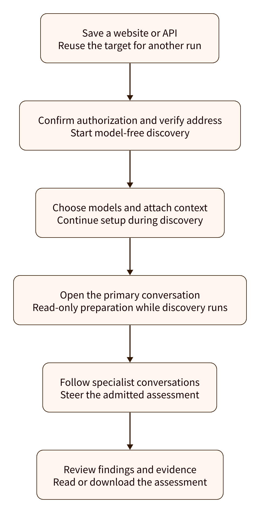
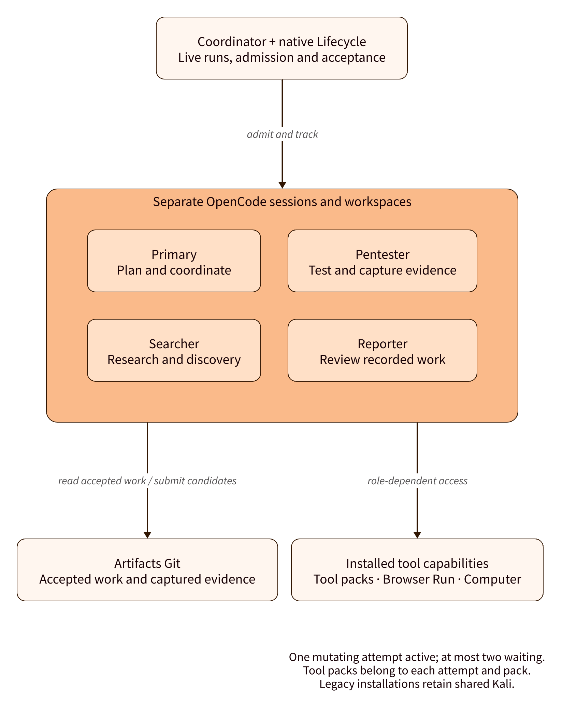
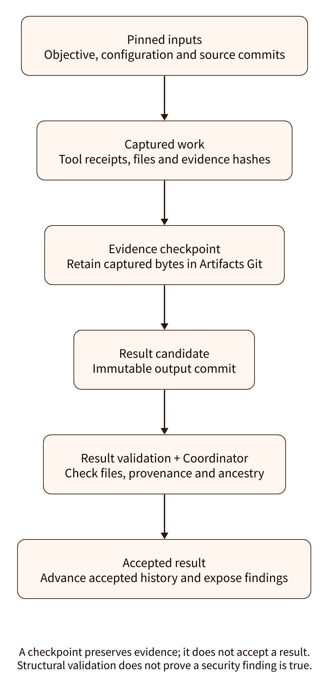
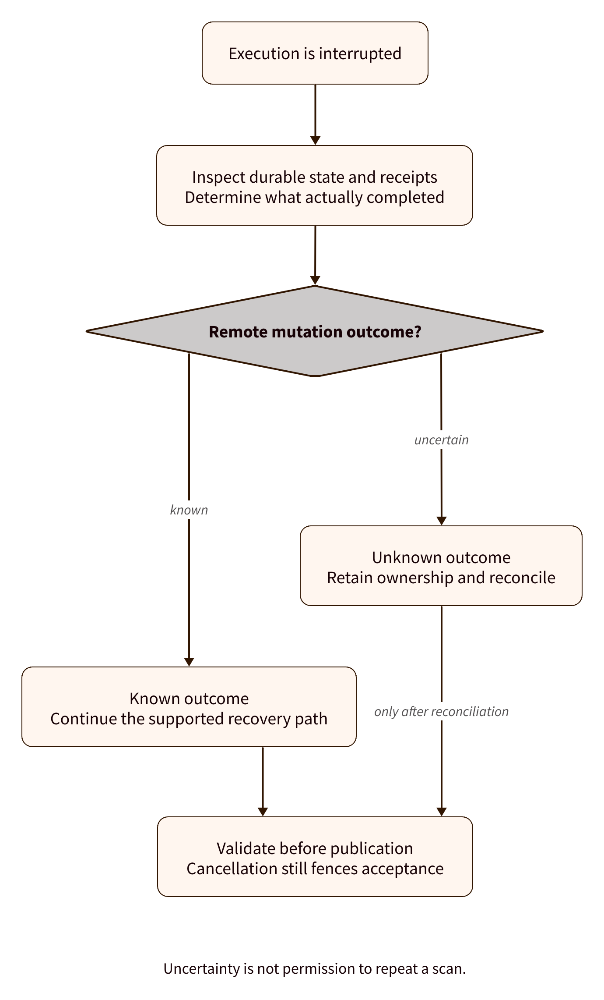
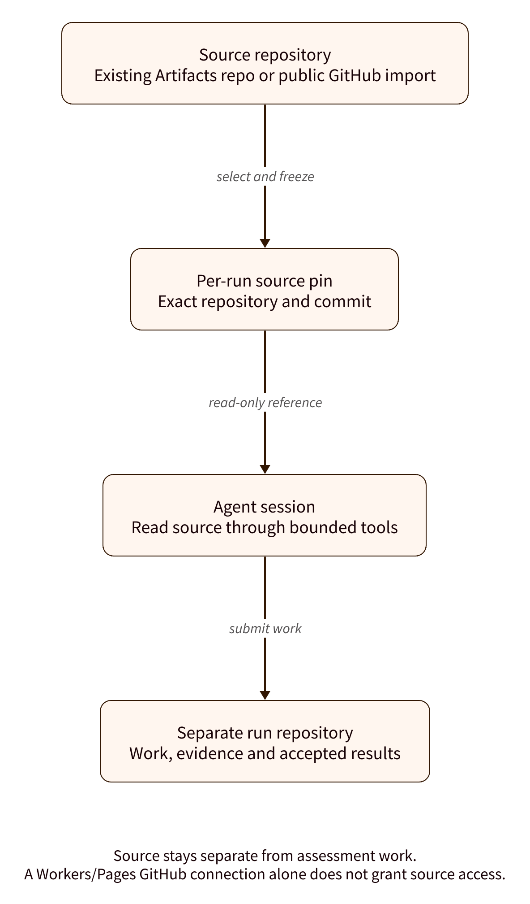
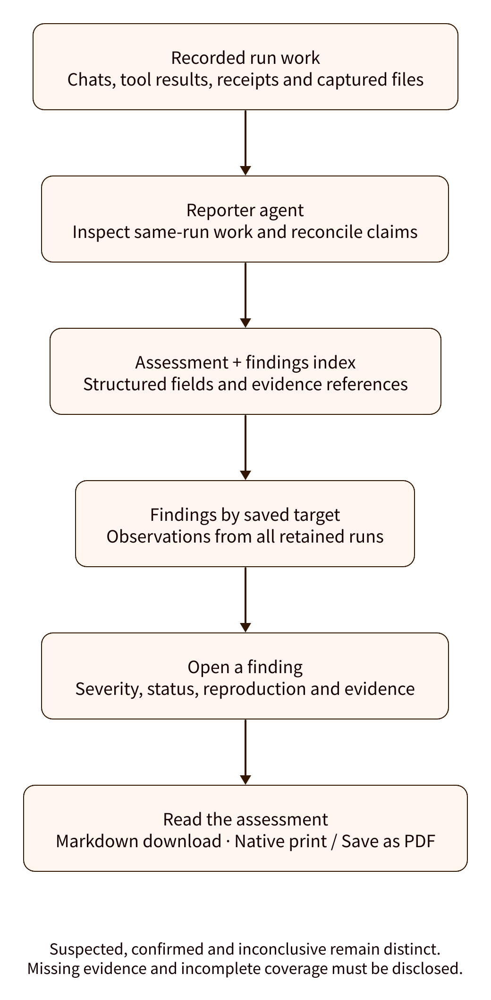
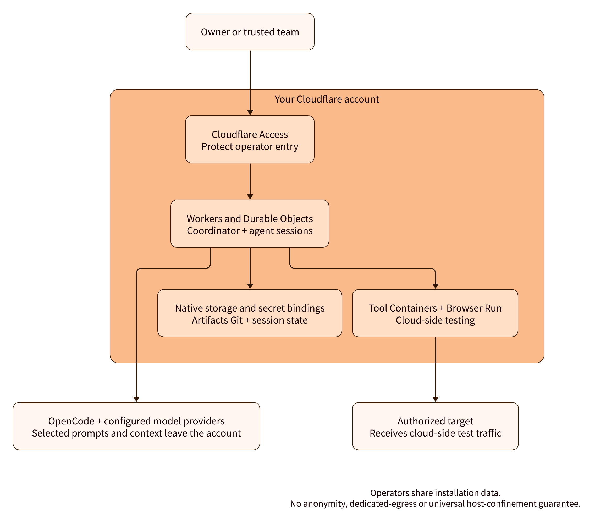

# How PentCloud works

PentCloud gives a project owner a visible, steerable investigation: save a target,
configure supported models, follow specialist conversations and review findings
with evidence. These figures explain the current design; they are not benchmark
results, screenshots or proof that any particular vulnerability was found.

## From target to assessment

Saving a target does not contact it. After authorization confirmation, the bounded
address check starts model-free discovery. Setup stays usable while the shared
scanner starts. The primary can hold a read-only preparation conversation after
model setup passes; execution/delegation waits for ordinary admission. Address
verification does not prove ownership or enforce network scope.
Optional program scope, identification headers and Cloudflare credential
references belong to the saved target. Runs pin that target revision; the model
receives its relevant instructions, not the entire scope catalog. Managed
requests pass through the shared target matcher. Browser Run adds native hostname
guardrails and narrow CDP interception while Chromium handles HTTP transport.
Kali retains direct Internet access without network scope enforcement. [Capabilities and limits](operations/onboarding.md#bounty-scope-and-target-login).

[Onboarding details and failure behavior](operations/onboarding.md).

## Separate conversations, shared accepted work

The roles shown are examples, not simultaneous scanning lanes. Each revision gets
a fresh native session/workspace. Coordinator SQLite is the live run/settings and
admission authority; one native queue allows one mutating attempt and at most two
waiting. Role-dependent tools reach Worker capabilities, Browser Run and one
shared stock Kali Container. Separate sessions do not provide network confinement.

## Evidence with a history

Artifacts Git holds immutable inputs, candidates, captured evidence and accepted
ancestry. A data checkpoint does not advance accepted history. The existing
ResultValidation Workflow provides candidate-validation hints; Coordinator
centrally verifies provenance and ancestry before acceptance. There is no
Workflow per specialist and no second Git control ledger.

Native OpenCode sessions hold conversations. Git is not the sole transcript
store or live-state authority. Evidence capture is bounded; expired/unrecorded
Kali scratch is not recoverable from Git. Structural validation is not independent
security verification. See [Kali evidence](operations/kali-evidence.md).

## Recovery respects uncertainty

An interrupted request does not prove that a scanner stopped. Native recovery
uses recorded state and operation receipts; unknown mutations keep their safety
ownership until reconciled. Captured evidence may finish a data-only checkpoint
while an owner drains, but this does not resume scanning/model work or accept a
result. Purge waits for safe drain. See [operations](operations.md).

## Source is context, not the work repository

Attach existing Artifacts source or import public GitHub source. Per-run pins
freeze exact commits. Read tools cannot push source changes, follow symlinks or
silently switch repositories. Private GitHub requires an Artifacts copy; an
existing Workers/Pages connection alone is not a source-access grant. Imported
source is untrusted context, and attachment does not prove full source coverage.
See [source context](operations/source-context.md).

## Findings connect the investigation to the report

The reporter can inspect terminal work, native conversation history, tool results,
remote-operation receipts, accepted Git files and verified evidence. It must
reconcile contradictions and disclose gaps. Findings from retained runs are
grouped by saved target ID; cross-run observations are not automatically merged.
Archived runs are included, Trash/purging runs are excluded. Each immutable
assessment remains separately selectable. See [findings](operations/findings.md).

## Your account, with explicit external services

One installation belongs to an owner or trusted team; admitted operators share
its data. Fresh installs start empty. OpenCode workspace keys use Cloudflare
bindings; configured BYOK provider keys stay in OpenCode. Prompts/context go to
configured external services. Targets/exclusions are guidance, not universal
host confinement. Professionals must configure engagement egress; no anonymity
or dedicated source-IP guarantee is provided. See
[authentication](operations/authentication.md), [hosted UI](operations/hosted-ui.md)
and the [network and data risks](../SECURITY.md#network-and-data-risks).

## Installation

Use the native Deploy to Cloudflare button, then open the app's `/setup` wizard.
Cloudflare and model providers have their own charges. Follow [deployment](deployment.md) and
[installation limits](../README.md#know-the-boundaries).

## Diagram sources

The [visual asset guide](../media/README.md) contains rendering instructions,
editable sources, font notices and the public interactive tour.
